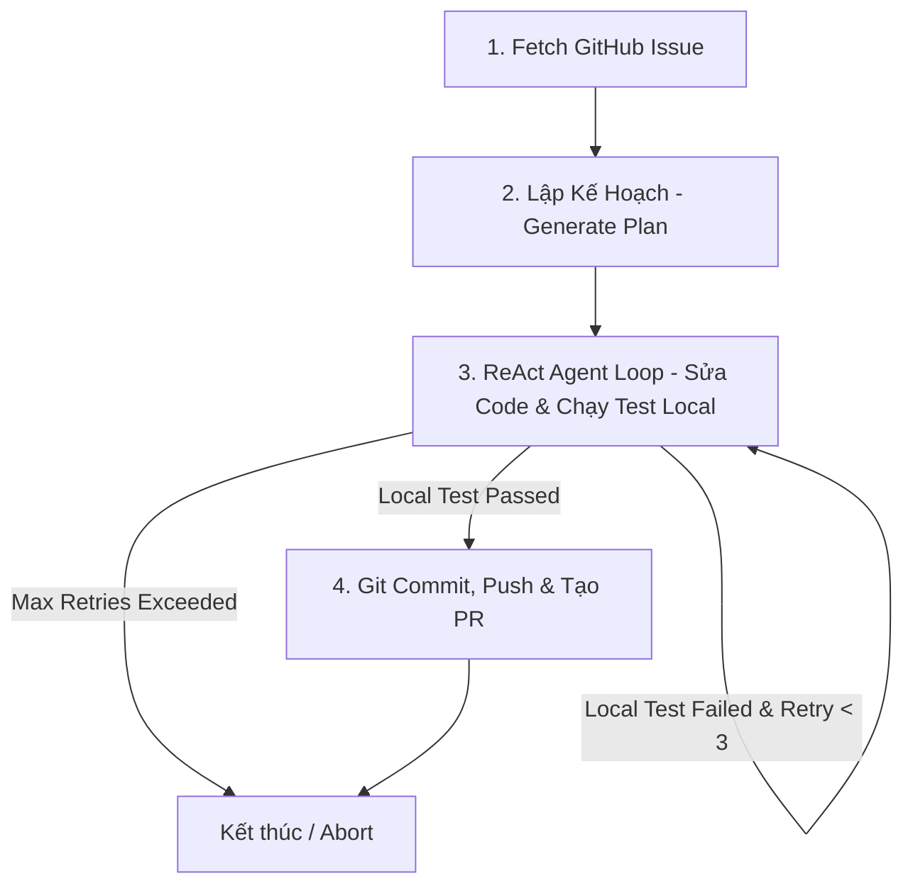

# 🚀 Auto-Dev Agent

**Auto-Dev** là một AI Coding Agent tự động hóa dựa trên **LangGraph** và **LangChain**, được thiết kế để đọc thông tin **GitHub Issue**, lập kế hoạch sửa lỗi, tự động chỉnh sửa codebase local, chạy bộ kiểm thử (Unit Tests), và tự động tạo **Pull Request (PR)** trên GitHub.

---

## 🌟 Tính Năng Nổi Bật

- **Đa LLM Provider**: Hỗ trợ **Antigravity CLI local (`agy`)**, Google Gemini (`gemini-2.5-flash`, `gemini-1.5-pro`), Anthropic Claude (`claude-3-5-sonnet`), OpenAI (`gpt-4o`), và OpenRouter.
- **ReAct Agent Loop**: Tự động tìm kiếm file (`search_code`, `find_files`), đọc file (`read_file`), chỉnh sửa mã nguồn (`edit_file`, `write_file`) và thực thi lệnh test local (`run_command`).
- **Tự động nhận diện Project Stack**: Tự phát hiện dự án Node.js / TypeScript (`npm test`), Go (`go test ./...`), hoặc Python (`pytest`).
- **Tự động hóa GitHub Authentication**: Tự lấy token từ GitHub CLI (`gh auth token`) khi máy đã đăng nhập GitHub SSH / `gh`.
- **Tự động tạo Pull Request**: Sau khi test trôi chảy (Passed), Agent tự tạo nhánh Git `fix/issue-<id>`, commit, push và tạo PR trên GitHub.

---

## 📋 Yêu Cầu Tiền Đề (Prerequisites)

1. **Node.js** (v18+ hoặc v20+).
2. **GitHub CLI (`gh`)** *(Khuyên dùng)*:
   ```bash
   brew install gh
   gh auth login
   ```
   *(Nhờ đó dự án sẽ tự đọc `GITHUB_TOKEN` mà bạn không cần phải tạo PAT thủ công).*

---

## 🔑 Cách Lấy Gemini API Key Miễn Phí (Google AI Studio)

Nếu bạn không có sẵn `GEMINI_API_KEY`, bạn có thể tạo một API Key **miễn phí (Free Tier)** rất dễ dàng:

1. Truy cập trang **[Google AI Studio - API Keys](https://aistudio.google.com/app/apikey)**.
2. Đăng nhập bằng tài khoản Google của bạn.
3. Bấm **Create API key** $\rightarrow$ Chọn một project và copy đoạn key dạng `AIzaSy...`.
4. Dán API key vào file `.env` của dự án (`GEMINI_API_KEY=AIzaSy...`).

---

## ⚙️ Cấu Hình Môi Trường (`.env`)

Tạo file `.env` tại thư mục gốc của dự án `auto-dev`:

```env
# Tên GitHub Repository bạn muốn làm việc (dạng owner/repo)
GITHUB_REPO=owner/your-repo-name

# LLM Provider mặc định (gemini | anthropic | openai | openrouter)
LLM_PROVIDER=gemini
GEMINI_MODEL=gemini-2.5-flash

# API Key cho Provider tương ứng
GEMINI_API_KEY=AIzaSyxxxxxxxxxxxxxxxxxxxxxxxxx

# (Tùy chọn) Nếu không dùng gh CLI, bạn có thể truyền thủ công GITHUB_TOKEN
# GITHUB_TOKEN=ghp_xxxxxxxxxxxxxxxxxxxxxxxxx
```

---

## 🛠️ Cài Đặt & Biên Dịch Dự Án

```bash
# 1. Cài đặt dependencies
npm install

# 2. Biên dịch TypeScript
npm run build
```

---

## 🚀 Hướng Dẫn Sử Dụng

### 1. Chạy Agent sửa lỗi cho một GitHub Issue

```bash
# Chạy với Provider mặc định đã cấu hình trong .env (ví dụ Gemini)
npm run dev -- run -i <ISSUE_NUMBER>
```

*Ví dụ:*
```bash
npm run dev -- run -i 12
```

### 2. Chọn Provider & Model trực tiếp từ CLI

- **Sử dụng Antigravity CLI local (`agy` / Antigravity IDE session):**
  ```bash
  npm run dev -- run -i 12 --provider antigravity-cli
  ```

- **Sử dụng Google Gemini (`gemini-2.5-flash`):**
  ```bash
  npm run dev -- run -i 12 --provider gemini --model gemini-2.5-flash
  ```

- **Sử dụng Anthropic Claude 3.5 Sonnet:**
  ```bash
  npm run dev -- run -i 12 --provider anthropic --model claude-3-5-sonnet-20241022
  ```

- **Sử dụng OpenAI (`gpt-4o`):**
  ```bash
  npm run dev -- run -i 12 --provider openai --model gpt-4o
  ```

- **Truyền API Key trực tiếp qua CLI (không cần file .env):**
  ```bash
  npm run dev -- run -i 12 --provider gemini -k AIzaSyYourApiKeyHere
  ```

---

## 🔄 Luồng Hoạt Động (Graph Workflow)



1. **Fetch Issue**: Lấy tiêu đề và mô tả của Issue từ GitHub.
2. **Generate Plan**: LLM phân tích Issue và tạo chiến lược sửa lỗi.
3. **Execute & Test (ReAct Loop)**: ReAct Agent tự chọn các tool local (`search_code`, `read_file`, `edit_file`, `run_command`) để sửa code và chạy test suite nhiều lần cho đến khi test pass thành công.
4. **Create PR**: Tạo branch `fix/issue-<id>`, commit thay đổi, push lên GitHub và tạo Pull Request tự động.

---

## 📂 Cấu Trúc Thư Mục Dự Án

```
auto-dev/
├── src/
│   ├── cli.ts           # Điểm vào CLI Command
│   ├── graph.ts         # LangGraph StateMachine Workflow
│   ├── llm.ts           # LLM Provider Factory (Gemini, Anthropic, OpenAI)
│   ├── profiler.ts      # Tự phát hiện Stack & Lệnh Test local
│   ├── types.ts         # Interface AgentState
│   └── tools/           # Bộ công cụ Agent (File System, Search, Terminal, GitHub)
│       ├── fs.ts        # read_file, write_file, edit_file
│       ├── search.ts    # search_code (ripgrep/git grep), find_files
│       ├── terminal.ts  # run_command
│       └── github.ts    # getGitHubIssue, createPullRequestTool, gh auth fallback
├── package.json
├── tsconfig.json
└── README.md
```

---

## 📄 License

ISC License.
