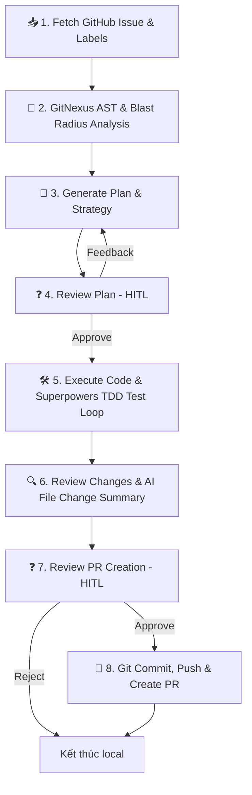

# 🚀 Auto-Dev Agent

**Auto-Dev** là một AI Coding Agent tự động hóa cao cấp dựa trên **LangGraph**, **GitNexus Engine** và **Superpowers Framework**, được thiết kế để đọc thông tin **GitHub Issue**, phân tích cú pháp AST & đồ thị tri thức codebase, lập kế hoạch sửa lỗi, tự động chỉnh sửa mã nguồn local, chạy bộ kiểm thử (Unit Tests TDD), và tự động tạo **Pull Request (PR)** trên GitHub.

---

## 🌟 Tính Năng Nổi Bật

- **GitNexus Codebase Intelligence**: Tự động phân tích cây cú pháp AST (Tree-sitter) và đồ thị phụ thuộc local để dự đoán chính xác **Blast Radius** (phạm vi ảnh hưởng) và chuỗi gọi hàm trước khi sửa code.
- **Superpowers TDD & Subagent Framework**: Áp dụng quy trình lập trình kỷ luật: **Brainstorming Socratic ➔ Plan Breakdown ➔ Subagent Execution ➔ TDD (Red-Green-Refactor)**.
- **Phân loại Issue & Commit Message Động**: Tự động nhận diện label từ GitHub Issue (`feature`, `enhancement` vs `bug`, `fix`) để sinh tên nhánh Git (`feat/issue-ID` / `fix/issue-ID`) và commit message chuẩn mực.
- **Smart Token Configuration**: Tích hợp các chế độ tối ưu token (`--token-mode cost-optimized`), giới hạn số lần lặp TDD (`--max-retries 2`), và bộ nhớ đệm (In-memory Cache 0ms) cho GitNexus.
- **Human-In-The-Loop (HITL) Review**: Tạm dừng xin xác nhận của con người trước khi thực thi code (`reviewPlan`), sau khi sửa code (`reviewChanges`), và trước khi tạo PR (`reviewPR`).
- **Đa LLM Provider**: Hỗ trợ **Antigravity CLI local (`agy`)**, Google Gemini (`gemini-2.5-flash`), Anthropic Claude (`claude-3-5-sonnet`), OpenAI (`gpt-4o`), và OpenRouter.

---

## 📋 Yêu Cầu Tiền Đề & Cài Đặt Dependencies

### 1. Yêu cầu hệ thống
- **Node.js** (v18+ hoặc v20+).
- **Git** và **GitHub CLI (`gh`)** *(Khuyên dùng)*:
   ```bash
   gh auth login
   ```

### 2. Cài đặt GitNexus CLI (Động cơ tri thức Codebase Local)
GitNexus chạy 100% ở Local để parse cây cú pháp AST mà không tốn Token LLM nào.
```bash
npm install -g gitnexus
```
*Sau khi cài đặt, Agent sẽ tự động gọi GitNexus để phân tích đồ thị tri thức khi chạy.*

### 3. Cấu hình Superpowers Framework
Superpowers là phương pháp luận lập trình agentic (`obra/superpowers`). **Auto-Dev Agent đã tích hợp sẵn quy trình Superpowers TDD & Subagent vào LangGraph StateMachine.**

*(Tùy chọn)* Nếu bạn muốn cài đặt bộ Superpowers Skills toàn cục cho các AI Agent khác (như Claude Code, Cursor, Antigravity CLI):
```bash
# Clone Superpowers skills vào thư mục cấu hình Agent toàn cục
git clone https://github.com/obra/superpowers.git ~/.agents/skills/superpowers
```

---

## 🔑 Cách Lấy Gemini API Key Miễn Phí (Google AI Studio)

Nếu bạn không có sẵn `GEMINI_API_KEY`, bạn có thể tạo một API Key **miễn phí (Free Tier)**:

1. Truy cập **[Google AI Studio - API Keys](https://aistudio.google.com/app/apikey)**.
2. Bấm **Create API key** $\rightarrow$ Copy đoạn key `AIzaSy...`.
3. Dán API key vào file `.env` (`GEMINI_API_KEY=AIzaSy...`).

---

## ⚙️ Cấu Hình Môi Trường (`.env`)

Tạo file `.env` tại thư mục gốc của dự án `auto-dev`:

```env
# Tên GitHub Repository bạn muốn làm việc (dạng owner/repo)
GITHUB_REPO=owner/your-repo-name

# LLM Provider mặc định (gemini | anthropic | openai | openrouter | antigravity-cli)
LLM_PROVIDER=gemini
GEMINI_MODEL=gemini-2.5-flash

# API Key cho Provider tương ứng
GEMINI_API_KEY=AIzaSyxxxxxxxxxxxxxxxxxxxxxxxxx
```

---

## 🛠️ Cài Đặt & Biên Dịch Dự Án

```bash
# 1. Cài đặt dependencies
npm install

# 2. Biên dịch TypeScript
npm run build
```

---

## 🚀 Hướng Dẫn Sử Dụng CLI

### 1. Nạp Task từ GitHub Issue HOẶC File Markdown Local (`.md`)

- **Chạy với GitHub Issue ID:**
  ```bash
  npm run dev -- run -i <ISSUE_NUMBER>
  ```

- **Chạy với File Markdown Local bất kỳ trong dự án:**
  ```bash
  npm run dev -- run -f docs/task.md
  # hoặc dùng agent link toàn cục:
  agent run -f ./tasks/feature-spec.md
  ```

### 2. Các Tùy Chọn Cấu Hình CLI (Command Options)

| Cờ CLI | Mô tả | Mặc định |
| :--- | :--- | :--- |
| `-i, --issue <number>` | GitHub Issue ID | - |
| `-f, --file <path>` | Đường dẫn tới file Markdown (.md) chứa yêu cầu Task local | - |
| `-p, --provider <name>` | LLM Provider (`gemini`, `anthropic`, `openai`, `agy`) | `anthropic` |
| `-m, --model <name>` | Tên model cụ thể (vd: `gemini-2.5-flash`, `claude-3-5-sonnet-20241022`) | - |
| `-y, --yes` | Tự động phê duyệt các bước HITL mà không cần hỏi lại | `false` |
| `--token-mode <mode>` | Chế độ tối ưu Token (`balanced`, `cost-optimized`, `performance`) | `balanced` |
| `--max-retries <num>` | Giới hạn số lần thử lại TDD/Test khi thất bại | `2` |
| `--subagents <mode>` | Chế độ thực thi subagent (`auto`, `on`, `off`) | `auto` |

*Ví dụ nạp Task từ file Markdown local và tối ưu Token:*
```bash
agent run -f docs/gitnexus-superpowers-integration.md --token-mode cost-optimized -y
```

---

## 🔄 Luồng Hoạt Động Kiến Trúc (LangGraph Workflow)



1. **Fetch Issue & Labels**: Lấy thông tin issue và phân loại `feat` / `fix` dựa trên GitHub label.
2. **GitNexus Analysis**: Truy vấn cây cú pháp AST và đồ thị phụ thuộc để xác định danh sách file ảnh hưởng và Blast Radius.
3. **Generate Plan**: LLM lập kế hoạch sửa lỗi chi tiết dựa trên thông tin tri thức từ GitNexus.
4. **Review Plan (HITL)**: Hỏi ý kiến con người để phê duyệt hoặc bổ sung context cho kế hoạch.
5. **Execute & Superpowers TDD**: Thực thi sửa code local và lặp kiểm thử TDD đến khi test pass.
6. **Review Changes**: Tổng hợp danh sách file thay đổi (`git status`), số dòng sửa (`git diff --stat`), và AI review summary.
7. **Review PR (HITL)**: Hỏi ý kiến con người trước khi đẩy code lên GitHub.
8. **Create PR**: Tạo branch `feat/issue-ID` hoặc `fix/issue-ID`, commit, push và tạo PR tự động.

---

## 📄 License

ISC License.
