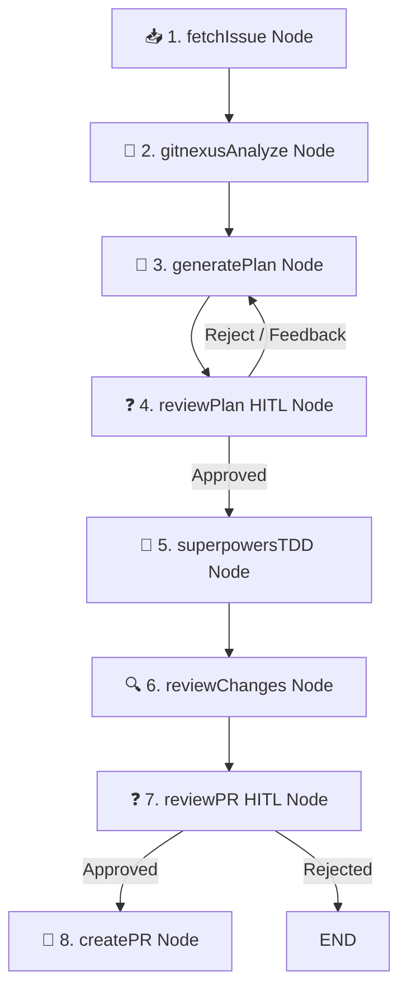

# Architectural Blueprint: Integrating GitNexus & Superpowers into Auto-Dev Agent

This document outlines the architectural design, specifications, and roadmap for integrating **GitNexus** (Code Intelligence Engine) and **Superpowers** (Agentic Workflow & TDD Framework) into `auto-dev-agent`.

---

## 1. Executive Summary & Vision

Current state of `auto-dev-agent`:
- **LangGraph StateMachine**: Orchestrates `fetchIssue` ➔ `generatePlan` ➔ `reviewPlan` ➔ `executeAndTest` ➔ `reviewChanges` ➔ `reviewPR` ➔ `createPR`.
- **Limitation**: The agent relies on LLM heuristics to locate buggy files and uses a simple, single-pass code modification approach.

Target state with **GitNexus** + **Superpowers**:
- **GitNexus Integration**: AST-level code intelligence via AST parsing and Knowledge Graph. Predicts exact **Blast Radius** and function call dependencies before planning.
- **Superpowers Integration**: Enforces a strict **Test-Driven Development (TDD Red-Green-Refactor)** workflow, Socratic spec clarification, and subagent task decomposition.

---

## 2. High-Level Architecture & Workflow



---

## 3. GitNexus Integration Details

### 3.1 What GitNexus Provides
- **AST Codebase Parsing**: Parses codebase syntax trees using Tree-sitter.
- **Dependency Graph**: Maps caller/callee function relations, class inheritance, and file dependencies.
- **Blast Radius Analysis**: Identifies all files and functions impacted by proposed changes.

### 3.2 Proposed Module: `src/tools/gitnexus.ts`
```typescript
import { execa } from 'execa';

export interface CodeGraphContext {
  affectedFiles: string[];
  callChains: string[];
  blastRadiusScore: number;
}

export async function analyzeCodebaseWithGitNexus(issueQuery: string): Promise<CodeGraphContext> {
  // 1. Run gitnexus CLI analysis
  await execa('gitnexus', ['analyze'], { cwd: process.cwd() });

  // 2. Query relation graph for target symbols / keywords
  const { stdout } = await execa('gitnexus', ['query', '--prompt', issueQuery], { cwd: process.cwd() });
  
  return JSON.parse(stdout);
}
```

### 3.3 State Enhancement
In `src/types.ts`:
```typescript
export interface AgentState {
  // ... existing properties
  codeGraphContext?: CodeGraphContext;
}
```

---

## 4. Superpowers Integration Details

### 4.1 What Superpowers Provides
- **Socratic Requirements Clarification**: Asks targeted questions to eliminate ambiguity.
- **Task Decomposition**: Breaks complex plans into discrete, verifiable sub-tasks.
- **Strict TDD Cycle**:
  1. **Red**: Write/update tests first and verify test failure.
  2. **Green**: Write minimal implementation code to pass tests.
  3. **Refactor**: Clean up implementation without breaking tests.

### 4.2 Enhanced Execution Node (`superpowersTDDNode`)
```typescript
async function superpowersTDDNode(state: AgentState): Promise<Partial<AgentState>> {
  // Step 1: Red Phase - Write Tests
  console.log('🔴 [TDD Phase 1/2] Writing Unit Tests & Verifying Test Failure...');
  // Execute test generator agent -> Run test command -> Assert FAILURE

  // Step 2: Green Phase - Implementation
  console.log('🟢 [TDD Phase 2/2] Writing Implementation Code & Verifying Test Success...');
  // Execute fix agent -> Run test command -> Assert PASS

  return { testPassed: true };
}
```

---

## 5. Implementation Roadmap

### Phase 1: GitNexus Intelligence Integration
- [ ] Install `gitnexus` CLI integration module (`src/tools/gitnexus.ts`).
- [ ] Add `gitnexusAnalyzeNode` before `generatePlanNode` in LangGraph workflow.
- [ ] Inject AST relation graph and Blast Radius data into `planNode` prompt.

### Phase 2: Superpowers TDD & Subagent Flow
- [ ] Create TDD prompt templates enforcing Red-Green-Refactor sequence.
- [ ] Update `executeAndTestNode` to enforce test-first creation.
- [ ] Implement subagent task loop for multi-task plans.

### Phase 3: Interactive HITL Controls
- [ ] Add interactive feedback loop at `reviewChangesNode`.
- [ ] Implement state checkpointer using `@langchain/langgraph` memory saver for pause/resume support.
